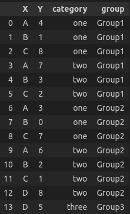
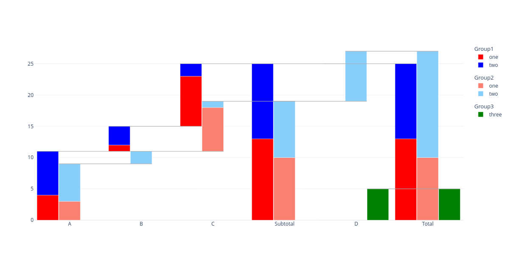

# plotlywaterfall

[](https://github.com/docdru/plotlywaterfall/actions/workflows/ci.yml)
[](https://pypi.org/project/plotlywaterfall/)
[](https://pypi.org/project/plotlywaterfall/)
[](https://github.com/astral-sh/uv)
[](https://github.com/astral-sh/ruff)

## Description 

A small package adding simple waterfall plotting capabilities on top of the plotly graphing package. Waterfall graphs are useful to display e.g. financial data such ans cashflow statements in an easily digestible format. 

While plotly includes basic capabilities to plot waterfall graphs, it ships only limited features. The *plotlywaterfall* package provides simple, plotly-express-style waterfall graphs with grouping, multiple stacked categories and variable colors. 

## Installation

Requires Python 3.11 or newer.

```bash
pip install plotlywaterfall
# or
uv add plotlywaterfall
```

## Usage

More examples can be found in the example notebook (https://github.com/docdru/plotlywaterfall/blob/main/examples/examples.ipynb). Let's use this dataframe for a simple yet complete example: 

    df = pd.DataFrame({
        "X": ["A", "B", "C"]*4 + ["D", "D" ], 
        "Y": [4, 1, 8, 7, 3, 2] + [i-1 for i in [4, 1, 8, 7, 3, 2]] + [8, 5],
        "category": ["one"]*3+["two"]*3 + ["one"]*3+["two"]*3 + ["two", "three"],
        "group": ["Group1"]*6 + ["Group2"]*6 + ["Group2", "Group3"]
    })




One can plot this data, with defined colors and automatic creating of total and subtotal, by using: 


    from plotlywaterfall.waterfall import Waterfall
    
    colors = {
        "Group1": {"one": "red", "two": "blue"},
        "Group2": {"one": "salmon", "two": "lightskyblue"},
        "Group3": "green"
    }


    c = Waterfall(df, x="X", y="Y", category="category", colors=colors, group="group", total=True, subtotals={"C": "Subtotal"})
    fig = c.get_fig()
    fig


Resulting graph:




## Disclaimer

I might maintain and improve the package. I might also not.

Known open points: 
- It is not possible to have mixed signs per X-value.
- I am note really happy with the interface for defining the colors.


## Development

The project uses [uv](https://docs.astral.sh/uv/) for environments and dependency locking.

```bash
git clone https://github.com/docdru/plotlywaterfall.git
cd plotlywaterfall
uv sync                       # creates .venv with the package + all dev tools
uv run pre-commit install     # optional: run checks on every commit
```

Common tasks:

| Task | Command |
|---|---|
| Run tests | `uv run pytest` |
| Tests with coverage | `uv run pytest --cov` |
| Test another Python | `uv run --python 3.11 pytest` |
| Lint / auto-fix | `uv run ruff check --fix` |
| Format | `uv run ruff format` |
| Type check | `uv run mypy` |
| Execute example notebook | `uv run pytest --nbmake examples/ -p no:warnings` |
| Open notebooks | `uv run --with jupyterlab jupyter lab` |
| Build sdist + wheel | `uv build` |

CI (GitHub Actions) runs lint, type checks, the test suite on Python 3.11–3.15 (Linux, plus Windows; macOS on `main` and the weekly run),
a test against the lowest supported dependency versions, the example notebook, and a package build.

### Releasing

1. Bump `__version__` in `src/plotlywaterfall/__about__.py` and add a `CHANGELOG.md` entry.
2. Commit, then tag and push: `git tag v0.9.4 && git push origin v0.9.4`.
3. The `Release` workflow builds the package and publishes it to PyPI via
   [Trusted Publishing](https://docs.pypi.org/trusted-publishers/) (no API token needed).

## Changelog

Refer to [CHANGELOG.md](https://github.com/docdru/plotlywaterfall/blob/main/CHANGELOG.md)